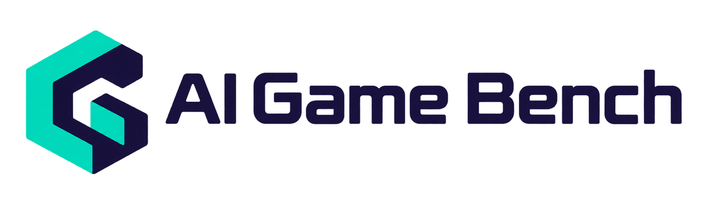

<p align="center">
  
</p>

**An open, evidence-first benchmark for AI game creation.**

[](https://github.com/mopan-ai/ai-game-bench/actions/workflows/checks.yml)
[](LICENSE)

[Results](https://www.aigamebench.com/) · [Methodology](docs/methodology.md) · [Quick start](#quick-start) ·
[Tasks](#tasks-and-evaluation) · [Platforms](#platform-support) ·
[Contribute](#contributing) · [Docs](docs/README.md)

Initiated by [Mopan](https://github.com/mopan-ai).
Results are published at [aigamebench.com](https://www.aigamebench.com/).

**Public preview:** free local calibration, six tested platform workflows and
public evidence submissions. Start with the free example below; real-platform
creation uses the [platform guides](#platform-support), not `agb run`.
[Current capabilities and limits](docs/project-state.md).

## Evaluation framework

The unit of comparison is a **game-creation system**: model, harness, tools and
platform under a declared configuration. Evaluate the delivered game, retain the
creation trajectory for diagnosis, and review the evidence behind each claim.

<picture>
  <source media="(max-width: 600px)" srcset="assets/diagrams/system-overview-mobile.svg">
  
</picture>

**C1–C5 mark contribution points**, not execution order. Start with a
[task, platform, grader, result or review](#contributing).

**Outcome quality · resource efficiency · diagnostic evidence.** Each task has
its own versioned rubric. Structural validity, gameplay success and provenance
review are separate claims; a green CI check does not establish all three.

[Methodology](docs/methodology.md) · [Terminology](docs/terminology.md) ·
[Architecture and repository map](docs/architecture.md) ·
[Research basis](docs/research/agent-evaluation.md)

## Quick start

Install [uv](https://docs.astral.sh/uv/getting-started/installation/), then run
on macOS/Linux (Windows: WSL):

```bash
git clone https://github.com/mopan-ai/ai-game-bench.git
cd ai-game-bench
uv sync --locked
uv run agb platforms
uv run agb submission policies
uv run agb submission validate examples/submissions/synthetic-counter
```

You should see the six platform references, available policies and a valid
synthetic package. The example is invented format-test data, **not** a game
score. These commands need no Docker or platform account, call no models and
upload nothing. To contribute, [work from your own fork](CONTRIBUTING.md).

### Run the free calibration

Start Docker, then:

```bash
uv run agb doctor
./scripts/run-smoke.sh
uv run agb view
```

Oracle should score 1, Nop 0, with no model calls. First use downloads dependencies
and browser images. Harbor owns runs and local `jobs/`. [Runbook](docs/running.md).

## Tasks and evaluation

| Task | What is available |
| --- | --- |
| [Click counter](datasets/smoke-create-v0.2/create-click-counter-zh-001/) | Free Harbor/Docker/Chromium calibration; automated interaction checks, not a game-quality score |
| [Classic Tetris](protocols/tetris-browser-pilot-v1/evaluation.md) | Browser observation and evidence protocol; no automatic creator or calibrated game judge |
| [2D platformer](protocols/platformer-browser-pilot-v2/evaluation.md) | Versioned browser-method proposal and pass/fault fixtures; live creator pilot still gated |
| [3D racing](protocols/racing-3d-browser-pilot-v2/evaluation.md) | Versioned browser-method proposal and pass/fault fixtures; live creator pilot still gated |

Choose a task and freeze its policy before recording. Keep creation evidence
separate from evaluation, and preserve failures, gaps and unknown values.
[Evaluation boundaries](docs/architecture.md) · [Add a task or policy](docs/adding-tasks.md).
[Platformer/racing proposal and validation plan](docs/proposals/platformer-racing-pilot.md).
[Measurement v0.2](docs/measurement.md) defines evaluator configuration,
explicit timeout/error accounting and offline summaries. Method code is merged;
the game protocols retain their proposed status and live-run acceptance gates.
Historical results stay unchanged.

### Evaluator calibration

The [experimental judge cohort](docs/judge-calibration.md) tests four focused
platformer/racing checks. It measures evaluator decisions, not creator quality.
Known fixtures support regression; held-out validation and human adjudication
remain next gates. [Calibration loop](docs/methodology.md#calibrate-the-evaluator) ·
[Acceptance examples](fixtures/calibration/gameplay-v1/README.md).

## Platform support

These platforms have been tested through **agent-operated workflows**.
`Tested` means a recorded test was performed, not that every game passed or that
the platform is certified. Each guide links to the corresponding report.

| Platform | Status | Execution |
| --- | --- | --- |
|  &nbsp; [Mopan](platforms/mopan/README.md) | Tested | Browser tool use |
|  &nbsp; [TapTap Maker](platforms/taptap-maker/README.md) | Tested | Browser tool use |
|  &nbsp; [Astrocade](platforms/astrocade/README.md) | Tested | Browser tool use |
|  &nbsp; [Manus](platforms/manus/README.md) | Tested | Browser tool use |
|  &nbsp; [Codex](platforms/codex/README.md) | Tested | CLI |
|  &nbsp; [Claude Code](platforms/claude-code/README.md) | Tested | CLI |

Reusable CLI integrations are planned. `agb run` currently executes only free
Harbor Oracle/Nop counter calibration, not these six creators.
[Support levels and setup](platforms/README.md) · [Add a platform](docs/platforms.md)

## Results and evidence

Browse the [results website](https://www.aigamebench.com/), or inspect a complete
public submission before making your own:

| Mopan Gemini 4 · Classic Tetris | Inspect |
| --- | --- |
| Original attempt | [Creation trajectory](submissions/mopan-gemini4-tetris-20261014/r001/creation.jsonl) · [Playtest trajectory](submissions/mopan-gemini4-tetris-20261014/r001/evaluation.jsonl) · [Evidence](submissions/mopan-gemini4-tetris-20261014/r001/evidence/) |
| Addenda | [Cost and usage](submissions/mopan-gemini4-tetris-20261014/r002/README.md) · [Fixed-policy scoring](submissions/mopan-gemini4-tetris-20261014/r003/README.md) |
| Maintainer decision | [Accepted with limitations](https://github.com/mopan-ai/ai-game-bench/pull/4#issuecomment-6162702189) · [Limited replay](reviews/mopan-gemini4-tetris-20261014/20261014/) |

Three revisions of **one creation**, not three attempts. This affiliated,
non-blind pilot is not independently reproduced generation or a calibrated
leaderboard. [Historical reports](reports/README.md) are references, not results
reproduced by this checkout.

Also accepted: [Mopan DS V4.1 1017 · Tetris](submissions/mopan-ds-v41-flash-1017-tetris-20261020/r001/)
with [maintainer review and stated limitations](https://github.com/mopan-ai/ai-game-bench/pull/10#pullrequestreview-5661885193).

## Contributing

No invitation is required. Choose a contribution point from the system map;
humans and agents follow the same guides. One person can contribute in several roles.

| I want to… | Start here |
| --- | --- |
| **C1 · Task author:** add a task or policy | [Prompt, rubric, acceptance steps and pass/fault examples](docs/adding-tasks.md) |
| **C2 · Platform integrator:** add a creation platform | [Connection guide and proposed adapter with free tests](docs/platforms.md) |
| **C3 · Evaluator author:** improve a grader | [Calibration cases, evidence audits and versioned corrections](docs/judge-calibration.md) |
| **C4 · Result contributor:** submit a trial | [Record evidence → prepare a public package → open one PR](docs/submissions.md) |
| **C5 · Reviewer:** inspect evidence or replay a build | [Record verification scope; Mopan maintainers decide acceptance](docs/reviewing-submissions.md) |
| Report a wrong verdict | [Open an issue](https://github.com/mopan-ai/ai-game-bench/issues/new?template=bug.yml) with reproduction evidence |
| Discuss an idea or ask for help | [Ideas](https://github.com/mopan-ai/ai-game-bench/discussions/categories/ideas) · [Q&A](https://github.com/mopan-ai/ai-game-bench/discussions/categories/q-a) |

Read the public-data terms below **before uploading**. Existing-task results go
directly to a PR; no prior Discussion or private workspace is required.

PR checks validate code, packages and free calibration. Maintainers separately
run trusted evidence checks and review the claims before merging. Green checks
are not evidence approval; website publication is a separate curated decision.
Discussions and submissions do not trigger paid runs or automatic deployment.

[Contribution guide](CONTRIBUTING.md) · [Actions and triggers](docs/contribution-workflow.md)
· [Maintainer review](docs/reviewing-submissions.md) · [Governance](GOVERNANCE.md)

Working with an agent? Give it the [contributor handoff](CONTRIBUTING.md#agent-handoff)
so it knows what to record, validate and ask permission to publish.

## Public-data and privacy terms

- **Everything you push to a public fork, PR, issue or Discussion is public
  immediately, even before acceptance.** Do not upload first and redact later.
- Publish only task-scoped evidence you have reviewed and have rights to share:
  relevant dialogue/actions, screenshots, game references, verdicts and cost
  provenance. Declare the evidence's license and any affiliation.
- Never upload credentials, cookies, Chrome profiles, unrelated conversations,
  full account/billing pages, signed URLs, private assets or whole raw jobs.
  Original Harbor records stay local; the submission is a reviewed export.
- Declare redactions, capture gaps and unknown values. If a necessary claim
  cannot be supported publicly, leave it unverified; do not silently omit proof.
- Agents need the owner's explicit publication approval before pushing. Automated
  scans are a backstop, not a privacy guarantee. Forks/caches may retain copies
  after deletion. Report accidental disclosure [privately](SECURITY.md).

By submitting, you confirm permission for public distribution and benchmark
review/display under the declared license. You retain your ownership. Code and
authored fixtures use [Apache-2.0](LICENSE); third-party evidence must state its
actual license. No additional training-data agreement is inferred from submission;
reuse follows the applicable license.

## Roadmap

- **Next:** an outside contributor completes the submission → review workflow.
- **Next:** validate the evaluator on unfamiliar platformer/racing implementations,
  then conduct a separately authorized creator pilot under frozen methods.
- **Planned:** a reusable browser adapter and evidence recorder, then more
  integrations through the unified CLI.

Propose a task, platform or review in
[Discussions](https://github.com/mopan-ai/ai-game-bench/discussions/categories/ideas).

## Contributors

<p>
  <a href="https://github.com/mopan-ai"></a>
  <br>
  <a href="https://github.com/mopan-ai">Mopan</a> — project initiation and maintenance.
</p>

Task authors, platform integrators and reviewers are welcome through the
[contribution guide](CONTRIBUTING.md). Tested platforms are not automatically
contributors or endorsers. [Platform logo attribution](platforms/LOGOS.md) ·
[AI Game Bench brand assets](assets/brand/README.md).
