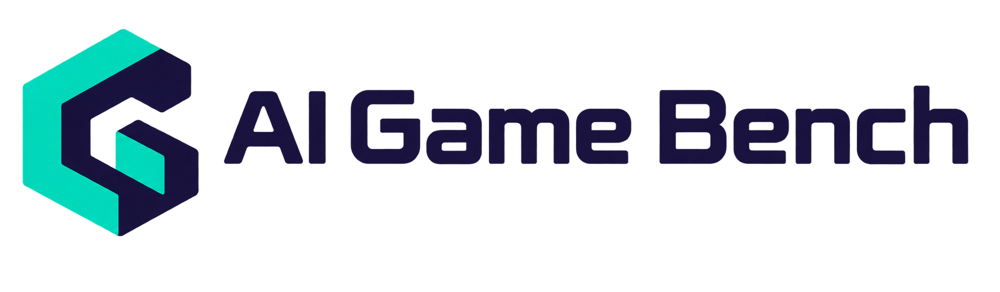

<p align="center">
  
</p>

**An open, evidence-first benchmark for AI game creation.**

[](https://github.com/mopan-ai/ai-game-bench/actions/workflows/checks.yml)
[](LICENSE)

[Get started](docs/getting-started.md) · [Tasks](docs/tasks.md) ·
[Platforms](platforms/README.md) · [Contribute](CONTRIBUTING.md) ·
[Results](https://www.aigamebench.com/) · [Docs](docs/README.md)

Compare game-creation systems through versioned tasks, playable artifacts and
evidence-backed evaluation. This repository holds the methods, tools and public
evidence; [aigamebench.com](https://www.aigamebench.com/) presents the results.

**Public preview:** free local calibration, documented platform workflows and
reviewed pilot submissions. Real-platform creation currently uses your own tools
and accounts. [Current capabilities](docs/project-state.md).

## How it works

<picture>
  <source media="(max-width: 600px)" srcset="assets/diagrams/workflow-mobile.svg">
  
</picture>

Evaluate the game separately from its creation process, then review the evidence
behind each score. Publication is curated; this flow does not imply fully
automated platform support.

[System map and contribution roles](docs/architecture.md) · [Methodology](docs/methodology.md)

## Quick start

Install [uv](https://docs.astral.sh/uv/getting-started/installation/), then:

```bash
git clone https://github.com/mopan-ai/ai-game-bench.git
cd ai-game-bench
uv sync --locked
uv run agb submission validate examples/submissions/synthetic-counter
```

This validates an invented format example. It needs no Docker or model account,
uploads nothing, and produces no game-quality score.

[Run the free calibration](docs/running.md) ·
[Test a real platform](docs/getting-started.md#test-a-real-platform) ·
[Understand the example](examples/README.md)

## Tasks and evaluation

- **Click counter** — runnable, free calibration of the local execution path.
- **Classic Tetris** — browser protocol with accepted, affiliated pilot evidence.
- **2D platformer** — browser method with focused pass/fault fixtures.
- **Web 3D** — six creation methods: racing, platformer, physics, target range,
  escape and simulation. Racing has accepted development-pilot evidence.

Browser methods are data-only protocols; they are not `agb run` adapters or
calibrated full-game judges. Choose an exact version before recording.

[Task catalog and policies](docs/tasks.md) ·
[Evaluator calibration](docs/judge-calibration.md)

## Platform support

Six platform guides document tested agent-operated workflows. **Tested** means
a recorded trial exists; reusable creator integrations in `agb run` remain planned.

| Platform | Status | Execution |
| --- | --- | --- |
|  &nbsp; [Mopan](platforms/mopan/README.md) | Tested | Browser tool use |
|  &nbsp; [TapTap Maker](platforms/taptap-maker/README.md) | Tested | Browser tool use |
|  &nbsp; [Astrocade](platforms/astrocade/README.md) | Tested | Browser tool use |
|  &nbsp; [Manus](platforms/manus/README.md) | Tested | Browser tool use |
|  &nbsp; [Codex](platforms/codex/README.md) | Tested | CLI |
|  &nbsp; [Claude Code](platforms/claude-code/README.md) | Tested | CLI |

Wanaka also has [racing pilot evidence](reports/README.md#accepted-evidence),
without a reusable platform guide yet. [Setup and support levels](platforms/README.md).

## Results and evidence

The [results index](reports/README.md) connects each task, submitted evidence,
maintainer decision and website report. Start with the
[three-platform racing pilot](reports/README.md#accepted-evidence) or the
[Tetris submissions](submissions/README.md).

Accepted evidence retains its stated limitations. A merged pilot is not an
independently reproduced result or a calibrated leaderboard entry.

## Contributing

Contribute a **task**, **platform guide**, **evaluator**, **result** or **review**.
Start with [CONTRIBUTING.md](CONTRIBUTING.md); humans and agents use the same
instructions. Existing-task results go directly to a PR. Maintainers review and
merge; website publication is a separate decision.

[Submit a result](docs/submissions.md) · [Add a task](docs/adding-tasks.md) ·
[Add a platform](docs/platforms.md) · [Ask a question](https://github.com/mopan-ai/ai-game-bench/discussions/categories/q-a)

## Public-data and privacy terms

**Uploads to public forks, PRs and Discussions are public immediately.** Share
only authorized, task-scoped evidence; keep credentials, profiles and raw jobs
local. Read the [public-data terms](docs/public-data.md) before uploading.

## Contributors

<p>
  <a href="https://github.com/mopan-ai"></a>
</p>

Initiated and maintained by [Mopan](https://github.com/mopan-ai).
Contributors are welcome. Tested platforms are not automatically contributors
or endorsers. [Logo attribution](platforms/LOGOS.md) · [Governance](GOVERNANCE.md).
