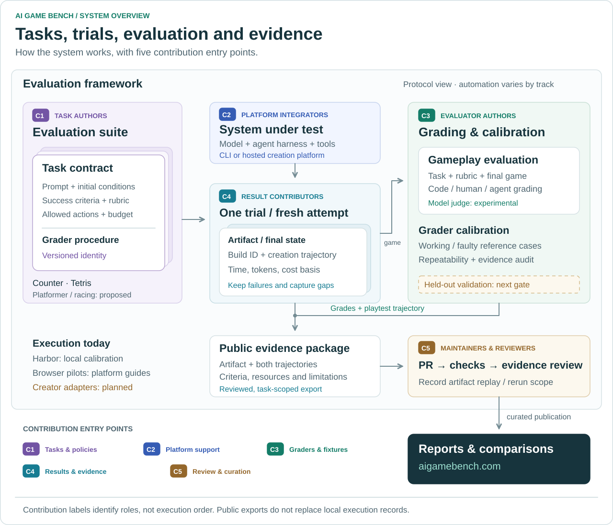

<p align="center">
  
</p>

**An open, evidence-first benchmark for AI game creation.**

[](https://github.com/mopan-ai/ai-game-bench/actions/workflows/checks.yml)
[](LICENSE)

[Get started](#quick-start) · [Framework](#evaluation-framework) ·
[Tasks](docs/tasks.md) · [Platforms](#platform-support) ·
[Contribute](#contributing) · [Results](https://www.aigamebench.com/) · [Docs](docs/README.md)

Compare game-creation systems through versioned tasks, playable artifacts and
evidence-backed evaluation. This repository holds the methods, tools and public
evidence; [aigamebench.com](https://www.aigamebench.com/) presents the results.
Initiated and maintained by [Mopan](https://github.com/mopan-ai).

**Public preview:** free local calibration, documented platform workflows and
reviewed pilot submissions. Real-platform creation currently uses your own tools
and accounts. [Current capabilities](docs/project-state.md).

## How it works

Compare a **game-creation system**: its model, agent harness, tools and platform.
Each task fixes what to build, the run conditions and how to judge the result.

<picture>
  <source media="(max-width: 600px)" srcset="assets/diagrams/workflow-mobile.svg">
  
</picture>

**Evaluate the game; review the evidence.** Gameplay verdicts come from playing
and testing the artifact. Creation records support diagnosis and review. The
figure marks where contributors can add tasks, platforms, evaluators, runs or reviews.

## Evaluation framework

The system map expands the workflow into its components and contribution points.
**C1–C5 identify roles, not execution order.** Task authors define the contract;
contributors record creation and playtesting; reviewers inspect the evidence.

<picture>
  <source media="(max-width: 600px)" srcset="assets/diagrams/system-overview-mobile.svg">
  
</picture>

| Component | What it means here |
| --- | --- |
| **Task and policy** | Versioned prompt, environment, interaction budget, success criteria and rubric |
| **Creator system** | Model, agent harness, tools and platform under a declared configuration |
| **Trial and trajectory** | One execution and its recorded actions, observations, interventions and resource use |
| **Artifact and gameplay evaluation** | The delivered game, tested separately against the task's criteria |
| **Evidence review** | A decision about which submitted claims are supported, with verification scope and gaps |

We track **outcome quality**, **resource efficiency** and **diagnostic evidence**.
Gameplay evaluation uses the game and allowed task information, independently of
the creation conversation. Creation records support diagnosis and provenance
review. Structural validity, gameplay success and independent reproduction are
different claims; a green CI check does not establish all three.

These figures describe the protocol. Platform automation and full-game evaluator
calibration remain limited. Standalone agentic play and autonomous improvement
benchmarks are future work, not current result tracks.

[Methodology](docs/methodology.md) · [Terminology](docs/terminology.md) ·
[Architecture and repository map](docs/architecture.md) · [Current capabilities](docs/project-state.md)

## Quick start

Install [uv](https://docs.astral.sh/uv/getting-started/installation/), then:

```bash
git clone https://github.com/mopan-ai/ai-game-bench.git
cd ai-game-bench
uv sync --locked
uv run agb platforms
uv run agb submission policies
uv run agb submission validate examples/submissions/synthetic-counter
```

These commands list platform references and policies, then validate an invented
format example. They need no Docker or model account, upload nothing and produce
no game-quality score. For a contribution, work from your own fork.

### Run the free calibration

Start Docker, then:

```bash
uv run agb doctor
./scripts/run-smoke.sh
uv run agb view
```

Oracle should score 1 and Nop 0, with no infrastructure exceptions or model calls.
These binary interaction checks are not game-quality scores. Harbor owns execution
and local jobs. First use downloads dependencies and browser images.

[Full runbook](docs/running.md) · [Test a real platform](docs/getting-started.md#test-a-real-platform) ·
[Understand the format example](examples/README.md)

## Tasks and evaluation

| Task | Current method and evidence |
| --- | --- |
| [Click counter](datasets/smoke-create-v0.2/create-click-counter-zh-001/) | Executable free Harbor calibration with known working and broken cases |
| [Classic Tetris](protocols/tetris-browser-pilot-v1/evaluation.md) | Browser protocol with accepted, affiliated pilot submissions |
| [2D platformer](protocols/platformer-browser-pilot-v2/evaluation.md) | Versioned browser method and focused pass/fault fixtures; no accepted public creator submission |
| [3D racing](protocols/racing-3d-browser-pilot-v2/evaluation.md) | Browser method with accepted Codex / Mopan / Wanaka development-pilot evidence |
| [Web 3D suite v1](protocols/web-3d-create-v1/README.md) | Six engine-agnostic methods: racing, platformer, physics, target range, escape and simulation; full-suite validation remains open |

Browser methods are data-only protocols; they are not `agb run` adapters or
calibrated full-game judges. Choose an exact version before recording.

[Task catalog and policies](docs/tasks.md) ·
[Add a task or policy](docs/adding-tasks.md) · [Measurement contract](docs/measurement.md)

### Evaluator calibration

Before comparing creators, check the evaluator against known working and faulty
games. The [experimental judge cohort](docs/judge-calibration.md) covers four
focused platformer/racing checks. It measures evaluator decisions, not creator
quality. Unfamiliar implementations, held-out validation and human adjudication
remain acceptance gates.

[Acceptance examples](fixtures/calibration/gameplay-v1/README.md) ·
[Calibration loop](docs/methodology.md#calibrate-the-evaluator)

## Platform support

Six platform guides document tested agent-operated workflows. **Tested** means
a recorded trial exists; reusable creator integrations in `agb run` remain planned.

| Platform | Status | Execution |
| --- | --- | --- |
|  &nbsp; [Mopan](platforms/mopan/README.md) | Tested | Browser tool use |
|  &nbsp; [TapTap Maker](platforms/taptap-maker/README.md) | Tested | Browser tool use |
|  &nbsp; [Astrocade](platforms/astrocade/README.md) | Tested | Browser tool use |
|  &nbsp; [Manus](platforms/manus/README.md) | Tested | Browser tool use |
|  &nbsp; [Codex](platforms/codex/README.md) | Tested | CLI |
|  &nbsp; [Claude Code](platforms/claude-code/README.md) | Tested | CLI |

Wanaka also has [racing pilot evidence](reports/README.md#accepted-evidence),
without a reusable platform guide yet. [Setup and support levels](platforms/README.md).

## Results and evidence

The [results index](reports/README.md) connects each task, submitted evidence,
maintainer decision and website report. For a complete submission example:

| Mopan Gemini 4 · Classic Tetris | Inspect |
| --- | --- |
| Original attempt | [Creation trajectory](submissions/mopan-gemini4-tetris-20261014/r001/creation.jsonl) · [Playtest trajectory](submissions/mopan-gemini4-tetris-20261014/r001/evaluation.jsonl) · [Evidence](submissions/mopan-gemini4-tetris-20261014/r001/evidence/) |
| Addenda | [Cost and usage](submissions/mopan-gemini4-tetris-20261014/r002/README.md) · [Fixed-policy scoring](submissions/mopan-gemini4-tetris-20261014/r003/README.md) |
| Maintainer decision | [Accepted with limitations](https://github.com/mopan-ai/ai-game-bench/pull/4#issuecomment-6162702189) · [Limited replay](reviews/mopan-gemini4-tetris-20261014/20261014/) |

These are revisions of **one creation**, not repeated attempts. Also inspect the
[DS V4.1 1017 Tetris submission](submissions/mopan-ds-v41-flash-1017-tetris-20261020/r001/)
and [three-platform racing pilot](reports/README.md#accepted-evidence).

Accepted evidence retains its stated limitations. A merged pilot is not an
independently reproduced result or a calibrated leaderboard entry.

## Contributing

No invitation is required. Humans and agents use the same guides; one person can
contribute in several roles.

| Contribution point | Start here |
| --- | --- |
| **C1 · Task author** | [Prompt, rubric, acceptance steps and pass/fault examples](docs/adding-tasks.md) |
| **C2 · Platform integrator** | [Connection guide and proposed adapter with free tests](docs/platforms.md) |
| **C3 · Evaluator author** | [Calibration cases and evidence-supported corrections](docs/judge-calibration.md) |
| **C4 · Result contributor** | [Record evidence, prepare a public package and open one PR](docs/submissions.md) |
| **C5 · Reviewer** | [Inspect claims or replay an artifact; record the verification scope](docs/reviewing-submissions.md) |

Existing-task results go directly to a PR; no prior Discussion or private
workspace is required. CI checks code and package structure. Mopan maintainers
review and merge; website publication is a separate curated decision.

[Contribution guide](CONTRIBUTING.md) · [Agent handoff](CONTRIBUTING.md#agent-handoff) ·
[Actions and triggers](docs/contribution-workflow.md) · [Governance](GOVERNANCE.md)

Report a wrong verdict with reproduction evidence in an
[issue](https://github.com/mopan-ai/ai-game-bench/issues/new?template=bug.yml), or
[discuss an idea](https://github.com/mopan-ai/ai-game-bench/discussions/categories/ideas).

## Public-data and privacy terms

**Uploads to public forks, PRs, issues and Discussions are public immediately.**
Share only authorized, task-scoped evidence with its license, affiliation and
capture gaps. Keep credentials, browser profiles, unrelated account data and raw
jobs local. Agents need the owner's publication approval before uploading.
Read the [public-data terms](docs/public-data.md) first; report accidental exposure
[privately](SECURITY.md).

## Roadmap

- Validate gameplay evaluators on unfamiliar implementations and adjudicate
  disputed cases before making stronger quality claims.
- Have an outside contributor complete submission → checks → maintainer review
  using only the public instructions.
- Develop reusable browser recording and creator integrations through the
  existing Harbor entry point, starting with free mocked tests.

[Current state and acceptance gates](docs/project-state.md#next-acceptance-gates)

## Contributors

<p>
  <a href="https://github.com/mopan-ai"></a>
  <br>
  <a href="https://github.com/mopan-ai">Mopan</a> — project initiation and maintenance.
</p>

Contributors are welcome. Tested platforms are not automatically contributors
or endorsers. [Logo attribution](platforms/LOGOS.md) · [Governance](GOVERNANCE.md).
