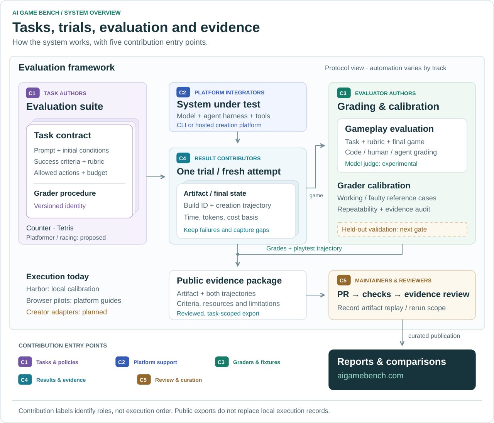

# Architecture and evaluation boundary

Read [methodology](methodology.md) for the measurement design and
[terminology](terminology.md) for the units. This page maps them to the existing
implementation; it does not introduce a second runtime.

## System overview

<picture>
  <source media="(max-width: 600px)" srcset="../assets/diagrams/system-overview-mobile.svg">
  
</picture>

Read the map as **definition → execution → grading → evidence review → report**.
Each task may have several fresh trials. The grader sees the task, rubric and
allowed game surface; creation telemetry goes separately to diagnosis/review.
This is the system's protocol view: Harbor owns native local execution, while
browser pilots currently follow platform guides. It does not imply a unified
creator adapter exists or that every proposed task has a calibrated evaluator.

## Contribution points

The C labels identify roles, not execution order or permissions. Contributors can
work on one part without implementing the whole system.

| Entry | Contribute | Location / handoff |
| --- | --- | --- |
| **C1 · Task author** | A prompt, platform-neutral policy, rubric, acceptance steps and positive/negative examples | `datasets/` for native tasks or `protocols/` for browser methods, plus `policies/`; [task guide](adding-tasks.md) |
| **C2 · Platform integrator** | A reproducible connection guide or proposed adapter, with a mocked lifecycle test | `platforms/`; use Harbor's execution interface for native adapters; [integration contract](platforms.md) |
| **C3 · Evaluator author** | A verifier, known defect case, calibration probe or evidence-supported correction | Task verifier or `fixtures/calibration/` / `calibration/`; [judge development](judge-calibration.md) |
| **C4 · Result contributor** | A fresh authorized trial, artifact reference, creation/evaluation trajectories, criterion evidence and resource records | Reviewed task-scoped export under `submissions/`; [submission guide](submissions.md) |
| **C5 · Reviewer / maintainer** | An exact-revision evidence audit, limited artifact replay or separately identified creation rerun | PR review, optionally scoped evidence under `reviews/`; [review checklist](reviewing-submissions.md) |

Method/code contributions use scoped PRs; changed frozen contracts need a new
version. Result contributions use public evidence packages. CI and trusted
structural checks do not replace claim review. Community members may contribute
review evidence; Mopan maintainers retain acceptance/merge authority. Website
curation happens separately in the landing repository, after publication approval.

## Repository map

| Layer | Location | Responsibility |
| --- | --- | --- |
| Task contracts | `datasets/`, `protocols/` | Executable Harbor tasks versus data-only browser procedures |
| Measurement policy | `policies/`, `scoring/` | Frozen identities, budgets, criteria and score mappings; historical addenda remain separate |
| Execution integration | `src/ai_game_bench/cli.py`, `platforms/` | Thin Harbor entry point and creator-platform references; references are not adapters |
| Game verification | `datasets/*/*/tests/` | Standalone file-to-JSON checks with a thin Harbor bridge |
| Evaluator development | `fixtures/calibration/`, `calibration/`, `src/ai_game_bench/judge_agent.py` | Authored examples and experimental gameplay-judge adapter |
| Public evidence | `submissions/`, `reviews/`, `reports/` | Immutable scoped exports, separate review evidence and report references |
| Validation and review automation | `tests/`, `scripts/`, `.github/` | Contract/regression checks and trusted structural review |
| Method documentation | `docs/` | Methodology, glossary, runbooks, research decisions and dated history |

`jobs/` and `artifacts/` are ignored local outputs, not public datasets. Frozen
paths stay stable because task identities, manifests and results refer to them.

## Native execution

```text
agb → Harbor task → agent → submission.json → isolated verifier → Harbor jobs/
                                                                      ↓
                                                                Harbor Viewer
```

`agb` resolves a local task and delegates execution to pinned Harbor 0.22.0.
It does not manage scheduling, retries, account sessions or an alternative result
store. Default run: one attempt, one concurrent trial, zero retries. Telemetry
is disabled for Harbor commands launched by the wrapper.

## Submission and verification

The current task accepts `/workspace/gamebench/submission.json`:

```json
{
  "schema_version": "0.1",
  "kind": "local_directory",
  "entrypoint": "/workspace/game/dist/index.html"
}
```

The verifier consumes that file plus a game directory and rubric, and emits
plain JSON. It does not import Harbor. `tests/test.sh` is the thin Harbor bridge.
The game bundle is frozen and hashed before a separate browser verifier runs.
Do not execute untrusted game/verifier code on a workstation outside a sandbox.

The calibration requires DOM selectors, and uses Playwright DOM interactions.
It is **not** pure-vision computer use and cannot evaluate arbitrary canvas/3D
games or external URLs. A future URL/screenshot track needs a separate task and
verifier version; it must not silently relax this offline contract.

There are two distinct artifact interfaces:

| Interface | Consumer | Meaning |
| --- | --- | --- |
| Game `submission.json` | Isolated counter verifier | A local bundle pointer or declared build failure |
| Public `manifest.json` | Submission validator / maintainer | A task-scoped evidence export; not executable job input |

The creator, gameplay evaluator and evidence reviewer have different roles.
The frozen game is the handoff from creation to evaluation; creation telemetry
is retained separately for diagnosis. Evidence review does not replace gameplay
grading, and grading does not authenticate capture provenance.

## Score honesty

| Outcome | Reward | Interpretation |
| --- | --- | --- |
| All counter checks pass | `overall=1` | This specific interaction contract passed |
| Missing/invalid submission or broken game | `overall=0` | Scored failure, reason retained |
| Valid `kind: build_failure` | `overall=0` | Creator reported a build failure |
| Browser setup / verifier infrastructure failure | No reward; Harbor exception | Evaluation did not complete |

`artifact_contract`, `runtime_smoke` and `gameplay_interaction` expose the layers.
Do not average these binary gates into a game-quality or model ranking score.
Harbor process exit zero alone does not prove success: `agb inspect` checks both
job and trial records. Nop scoring zero with no exception is a successful
negative calibration.

For comparisons, freeze task, rubric, evaluator, attempts, interaction policy and
runtime conditions. Record creator identity/model/effort as unknown when unseen.
Do not infer backend model identity from a marketing label. Preserve measured
duration, credit valuation, model-cost estimate and actual payment separately.

## Data and publication

`jobs/` is the canonical local Harbor record, excluded from Git. Public report
references and evidence exports do not replace trial JSON. The public export uses
`manifest.json` with schema `public-submission/0.1`; it is distinct from the
game-to-verifier `submission.json` contract above. Existing frozen task bytes are
unchanged. `policies/` pins their identity and the export's score mapping.

`agb submission` creates/checks publication exports, not runs or a second result
database. Browser observations may use the same export once their task/policy is
approved; they are never misrepresented as native Harbor trials. The validator
does not execute submitted code or fetch URLs. Maintainers use a trusted revision
and independently inspect evidence, not contributor-authored checks.

Data-only browser protocols live in `protocols/`, outside executable Harbor
datasets. Their policy pins a manual `evaluation.md` procedure. They support
transparent pilot observations while an unattended adapter/verifier is absent;
they do not create a parallel runtime, job store or automatic judge.

Public submission data is public by default, with pre-upload rights/privacy
confirmation. Credentials, private content and whole raw jobs never enter Git.
No additional training agreement is inferred; reuse follows the declared license.
See [public-data terms](../README.md#public-data-and-privacy-terms).

The [v0.2 measurement contract](measurement.md) adds evaluator metadata,
separate timeout/error semantics and offline selected-set summaries. It uses the
same export path; v0.1 records and frozen task/verifier bytes remain unchanged.
These numeric checks are not an independent gameplay evaluator or a leaderboard.

The separate [judge development calibration](judge-calibration.md) prepares local
Harbor tasks from existing pass/fault fixtures. A host Codex adapter forwards
restricted screenshot/input tools to a browser inside Harbor's container; a
standalone file-to-JSON verifier compares the verdict with a separately held
label. Native jobs remain authoritative. This is focused offline calibration,
not a generic remote-game adapter or calibrated full-game quality score.
