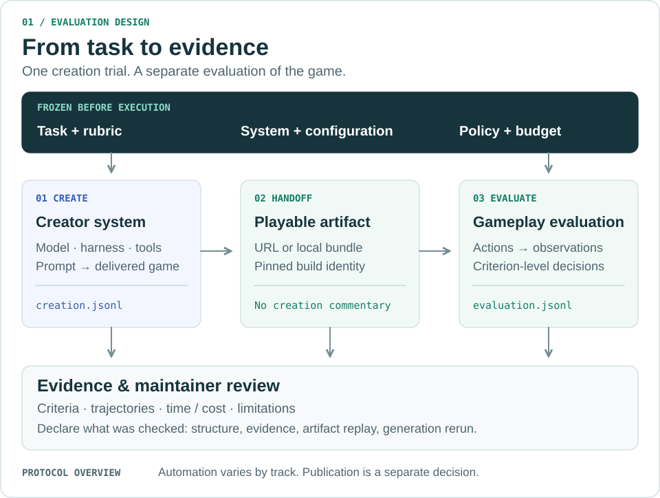
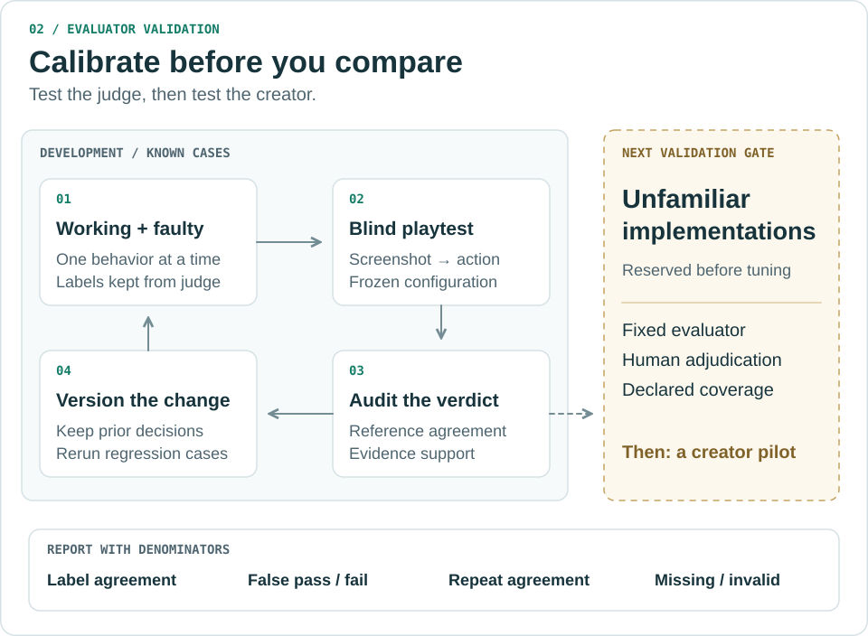

# Evaluation methodology

AI Game Bench studies **game-creation systems**: a model acting through a harness,
tools and a platform. The primary observation is a delivered game and its behavior
under a versioned test protocol. A creator's completion message is not a passing
test. The public preview covers creation; standalone game-playing and autonomous
improvement benchmarks are future work.

This is the repository's measurement framework, informed by the
[research and engineering references](research/agent-evaluation.md). It is not an
external certification or a claim that all evaluators are already calibrated.
See [current implementation status](project-state.md).

## Experimental unit

One **trial** is one fresh attempt at a pinned task under a declared configuration.
Its record connects:

**Task + system + protocol → artifact + creation trajectory → evaluation + evidence.**

<picture>
  <source media="(max-width: 600px)" srcset="../assets/diagrams/evaluation-overview-mobile.svg">
  
</picture>

Record the task/policy hashes, creator model and harness, evaluator configuration,
environment, budgets, timestamps and interventions. An exported revision or a
second review of the same build is not a new creation trial. Unknown backend
identity stays unknown; a UI model label is an observation, not an attestation.
The [terminology guide](terminology.md) maps these concepts to actual files.

## What is measured

| Construct | Observable evidence | Interpretation |
| --- | --- | --- |
| Functional correctness | Criterion-specific actions and resulting game state | Does the delivered build satisfy the task? |
| Player experience | Anchored observations of controls, feedback, legibility and presentation | A rubric judgment with a stated reviewer and scope |
| Resource efficiency | Accepted-prompt and delivery times; usage and cost receipts | Time and cost under disclosed accounting boundaries |
| Process diagnostics | Creation actions, follow-ups, retries, tool outputs and capture gaps | Where the process became slow or failed; not a substitute for playing |
| Evidence quality | Build identity, linked observations, hashes and review notes | How well a claim is supported; not extra game-quality points |

These outcome, trajectory and component views follow the diagnostic distinction
in [Confident AI's evaluation guide](https://www.confident-ai.com/blog/llm-agent-evaluation-complete-guide).
For closed platforms, component-level attribution is limited to exposed evidence.

These are analysis dimensions, **not a new scoring policy**. Existing policies
define their own criteria, weights and gates. Compare correctness alongside time
and cost; a cheap failed creation is still a failure. Keep model-cost estimates,
credit valuations and actual payments distinct. Historical scores are unchanged.

## Evaluation and review are separate

- **Code-based verification** checks an explicit contract. The counter verifier
  uses DOM interactions; authored gameplay probes test particular fixtures.
- **Model-based grading** requires a pinned evaluator and calibration. The local
  judge experiment uses screenshots and ordinary player controls on four probes.
- **Reviewer judgment** inspects evidence and may replay an artifact. Record
  whether the reviewer is human or AI-assisted, their affiliation and blinding.

A gameplay evaluator should receive the task, rubric and game surface, without
creator commentary or expected answers. Declare any source/DOM access and context
leakage. Information separation does not establish organizational independence.
For hosted games, grade visible behavior and record the URL/build/test time;
missing source code does not justify inventing internal observations.

Creation telemetry remains available for diagnosis and provenance review. Record
observable actions and outputs; private prompts or hidden reasoning are not
required. Exact tool order is relevant only where the protocol requires it.

## Calibrate the evaluator

<picture>
  <source media="(max-width: 600px)" srcset="../assets/diagrams/evaluator-calibration-mobile.svg">
  
</picture>

The [development cohort](judge-calibration.md) exercises existing platformer and
racing checks. Report label agreement, false passes, false failures, abstentions,
invalid/missing trials and repeat agreement with their denominators. Inspect
whether cited evidence actually supports the verdict. Agreement with a label and
a correctly hashed screenshot do not by themselves establish sound judgment.

Known fixtures support regression testing. Unfamiliar implementations reserved
before tuning are needed to assess generalization; repeated trials of one fixture
are not additional independent games. A perfect small development result does
not establish full-game or subjective-quality accuracy. The held-out gate and
human adjudication remain work to do.

## Validity and failure analysis

| Question | Required analysis |
| --- | --- |
| **Construct validity:** are we measuring the intended capability? | Map each criterion to a task requirement; test real motion, not just a changing HUD. |
| **Internal validity:** what caused the result? | Separate game defects, evaluator mistakes, task ambiguity and infrastructure errors. |
| **Reliability:** does the measurement repeat? | Pin configurations, use fresh contexts, retain every trial and inspect disagreement. |
| **External validity:** where does it generalize? | Disclose game families, access modes and sample size; test unfamiliar implementations. |

For a disputed verdict, inspect **requirement → acceptance step → observed state
→ criterion decision**. Check for unstated requirements, unnecessary implementation
constraints, missing failure cases and contradictions. Resolve benchmark defects
with a new method version; do not silently rewrite historical scores.
This task-audit step is informed by
[OpenAI's coding-evaluation analysis](https://openai.com/index/separating-signal-from-noise-coding-evaluations/).

For example, the existing `hud-only-speed` fixture should fail a motion check
despite a moving speedometer. A `no-brakes` test needs a matched coasting comparison
before collision. These are useful failure mechanisms, not universal scripts for
every game's implementation. [Acceptance cases](../fixtures/calibration/gameplay-v1/README.md).

## Aggregation and claim scope

Use the pinned policy's scoring and [measurement rules](measurement.md). Under
v0.2, untested criteria earn no credit but remain distinct from observed defects;
infrastructure-invalid measurements have null totals and explicit exclusions.
Always show attempted/expected counts and relevant denominators.

Group only compatible task, policy, creator and evaluator configurations. Never
select the best retry without disclosing the selection. The existing summary is
an offline aggregation of submitted claims; it does not establish a population
ranking, confidence interval or calibrated gameplay result.

Maintainer review separately records **structural validation, evidence review,
artifact replay and generation rerun**. None alone authenticates an entire
trajectory. [Review contract](reviewing-submissions.md).

The improvement loop is concrete: retain a failure case, identify its cause,
version the affected method or system, rerun a matched cohort, and inspect both
improvements and regressions. Automatic optimization or training is outside the
current implementation.
